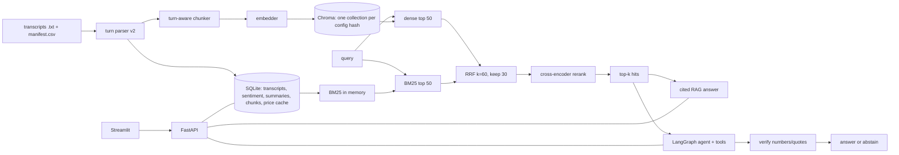

# Architecture and design decisions

## Decisions

**Hybrid retrieval.** Earnings calls mix exact tokens (product names, `$26.0 billion`, `Q3`) with paraphrased concepts.
BM25 wins the first, dense the second. Reciprocal Rank Fusion needs no score calibration, so the two score scales
never have to be compared. The reranker only sees the 30 fused candidates, which keeps CPU latency reasonable.

**Context header, embedded but not stored.** `NVDA | Q4 2026 | Name (management) | Q&A` is prepended for embedding and
reranking so a bare passage like "demand remains strong" still knows which company and quarter it belongs to. The stored
text stays clean for display, BM25 and span matching.

**Collections named by config hash.** Changing chunk size, overlap or embedding model produces a different hash and a
different Chroma collection, so an experiment can never silently reuse vectors from another configuration (v1 finding F4).

**Evidence as spans.** Ground truth is verbatim text, not chunk ids, so one question set scores every chunking strategy.
Fuzzy matches require every number in the span to be present (a different figure is a different fact).

**JSON-action agent instead of native tool-calling.** Small free local models are unreliable at provider-specific
tool-call formats but can follow "reply with one JSON object". Pydantic validation turns malformed calls into
observations the model can correct. Routing is heuristic so single-fact questions do not pay for a loop.

**Verify, retry once, abstain.** The verifier is a deterministic string check, not another LLM, so it cannot hallucinate
approval. It is conservative by design and refuses model-computed numbers.

**Free judge.** The PRD suggested a stronger paid judge. Here the judge is a local open model from a different family
than the generator (reduces self-preference bias), run at temperature 0 with cached judgments and a hand-audit helper.
This costs nothing but gives noisier judgments than a frontier model, so retrieval metrics (judge-free) carry the headline claim.

**FinBERT never loads at serve time.** Sentiment is a batch job; the API and UI only read cached rows. torch is imported
lazily so the API image logic and the whole test suite run without it.

**Price convention.** The after-close assumption is documented in the README; a call that happens pre-market would need a
different baseline, which is a known simplification.

## Failure handling

LLM down or model missing → typed `LLMError`, surfaced as a friendly message (summaries, `/v1/ask`) or an `error` event (agent).
yfinance failing → SQLite cache → snapshot CSV → an error observation the agent relays. Tool bugs and timeouts never
crash the graph. Rate limits and write-endpoint auth protect a public deployment.
